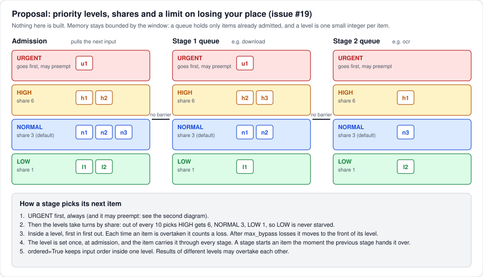
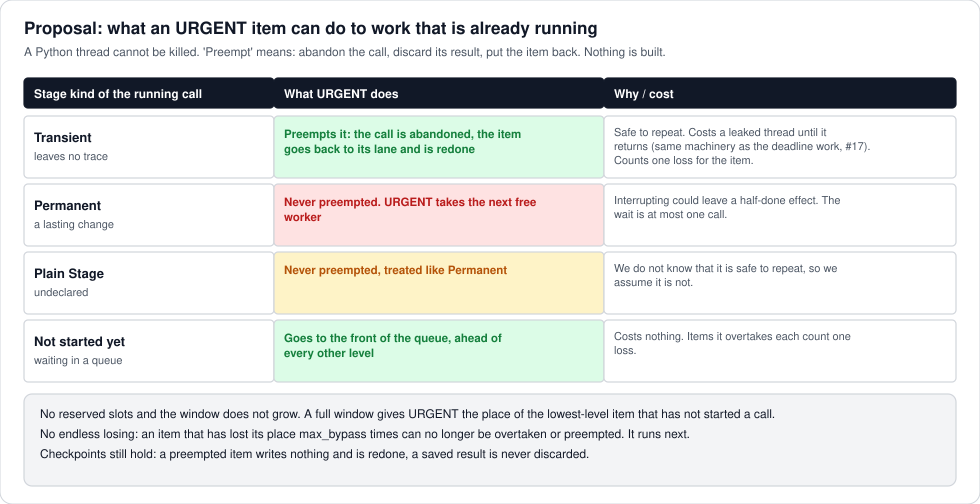

# Item priority: `priority=`, shares, `URGENT`

Status: **proposed, for the maintainer's review**. Nothing here is built. Issue:
[#19](https://github.com/rafaelborja/stagepipe/issues/19). The maintainer rates this as important.
Direction below comes from the maintainer's answers of 2026-10-15; the details I filled in are marked
**(to confirm)**.

## The need

Today every stage queue is first in, first out. An item that matters now waits behind everything fed before
it. We want an opt-in way to give an item a higher priority, so the next free worker takes it first, with
rules that keep low-priority work from starving. Default behaviour stays as it is.

## The model

1. **Defining a priority.** A level is a small integer. Named constants: `URGENT`, `HIGH`, `NORMAL` (the
   default), `LOW` **(to confirm: names and count)**. Given by `run(..., priority=fn(item))` for items the
   library already pulled. For items that arrive while a run is going, a small thread-safe
   `PrioritySource` (`put(item, level)`, `close()`) that `run()` iterates **(to confirm)**: admission can only
   choose among items it can see, so a live source is what makes "an urgent item arrived" possible.
2. **Admission is the first stage's priority.** The level is set once, when the item is admitted, and it
   travels with the item through every stage. Each stage's queue serves by that level. No per-stage
   priority function.
3. **No barriers.** A stage starts an item the moment the previous stage hands it over. The item keeps its
   level, so a high-level item finishing stage 1 goes ahead of lower-level items waiting for stage 2.
4. **No starvation, two guards.**
   - **Shares per level** (`shares={HIGH: 6, NORMAL: 3, LOW: 1}`, defaults like these). Every stage's queue
     takes turns by weight, so even `LOW` gets its slots. A level with nothing waiting gives its turn away.
   - **`max_bypass=N`**: each time an item is overtaken it counts a loss. After N losses it moves to the
     front of its level and can no longer be overtaken or preempted. Two guards because shares protect a
     whole level, `max_bypass` protects a single item.
5. **`URGENT`.** Always first, and outside the shares. No reserved slots. It may preempt, depending on what
   is running:

   - `Transient` stage: preempted. The call is abandoned, its result discarded, the item goes back to its lane
     and is redone. This is the abandon machinery of [deadline.md](deadline.md) (#17), with the same costs:
     a leaked thread until the call returns, the limiter held until then, a fresh `init` state.
   - `Permanent` and plain `Stage`: never preempted. `URGENT` takes the next free worker. A plain `Stage`
     declares nothing, so we assume the worst.
   - A preempted item counts a loss, so `max_bypass` bounds repeated preemption.

## Rules that follow

- **A call already running is never interrupted by force**; a Python thread cannot be killed. Preempting
  means abandoning, and it is available only for `Transient` stages and only with the abandon machinery.
  Until #17 is built, `URGENT` can still jump every queue but cannot stop a running call.
- **Memory stays bounded by the window.** A level is one small integer per item, a loss counter is another.
  Queues hold only admitted items. The window does not grow for `URGENT`; if it is full, `URGENT` takes the
  place of the lowest-level item that has not started a call, and that item waits parked, with its input
  still held, not lost **(to confirm)**.
- **`ordered=True`**: order holds inside one level. Results of different levels may overtake each other,
  since waiting for earlier, lower-level items would defeat the point. Gap tokens are per level.
- **Checkpoints**: a preempted item writes nothing and is redone. Saved results are never discarded. A
  restored item gets its level again from `priority=fn(item)`.
- **Stats**: `Stats.preempted`, and per-level counts of items run and the longest wait **(to confirm)**.

## Open questions

1. Levels: four named levels, or any integer? Names make `URGENT` special; integers make the shares table
   longer.
2. `PrioritySource` or a different way to feed live items (a plain `queue.PriorityQueue` wrapped by a
   helper)? A tiny class costs less than documenting a pattern.
3. Window full and `URGENT` arrives: park the lowest-level item (above) or allow a small fixed overflow?
   The maintainer said no reserved slots, so parking is the proposal.
4. Defaults for `shares` and `max_bypass`. Suggested: `6/3/1` and `max_bypass=8` **(to confirm)**.
5. Should an item's level be able to rise while it waits (aging), or is `max_bypass` enough? Proposal:
   `max_bypass` only, because it is simpler and bounded.
6. Should `Transient` stages choose whether they can be preempted (`preemptible=False` for a stage that is
   safe to repeat but expensive to redo)? Proposal: yes, default on once #17 exists.

## Tests to write if built

1. Four levels fed together: `URGENT` runs first, the rest follow the shares, `LOW` is never skipped for more
   than a bounded number of picks.
2. `max_bypass`: an item overtaken N times is served next, even by a stream of `HIGH` items.
3. `URGENT` arrives with every worker busy in a `Transient` stage: the call is abandoned, `URGENT` runs, the
   preempted item is redone and counts a loss.
4. Same with `Permanent` and a plain `Stage`: no preemption, `URGENT` waits for the next free worker.
5. Window full: memory stays within the bound, the parked item finishes later.
6. `ordered=True`: order holds inside a level, levels may overtake.
7. A level carried through two stages without a barrier; checkpoint restore recomputes the level.
8. Default run (no `priority=`): identical order and timing to today.
